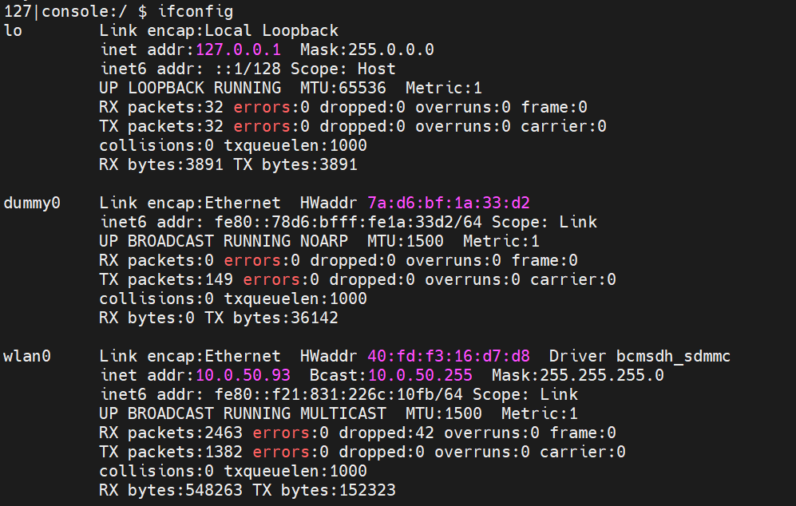
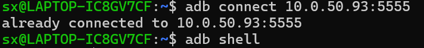

# 准备原厂 Android，再启动 PatchX Linux

## 1. 确认是否需要烧录

| 手头的设备状态 | 操作入口 |
| --- | --- |
| 3568A 测试板已能正常进入原厂 Android | 直接做下文的串口和网络准备 |
| 只有厂商 Android 镜像，板卡尚未装系统或需要恢复 | 使用供应商对这块板型和镜像明确配套的烧录流程 |
| 要验证 PatchX Linux | 从原厂 U-Boot 把临时启动包读入 RAM，测完重启回 Android |

原厂 Android 烧录需要先确认板号、镜像版本、封装格式、存储介质和供应商指定的烧录工具。已有出厂系统时先备份需要保留的数据和分区。首次烧录或恢复 Android 之后，确认能进系统并能通过调试串口看到启动日志。这个仓库提供已验证的 Linux RAM 启动流程。永久安装 PatchX Linux 所需的整机镜像与刷写步骤尚未验收。

## 2. 没有网络时，先通过串口确认板卡状态

连接板卡调试串口。实测参数是 1500000、8N1、无流控。电脑与板卡的串口收发线交叉连接，并共地。

串口独立于 Wi‑Fi，之前的Android内核会反复打印`rk817-bat`电池状态和充电调试日志，比较讨厌，因此需要临时降低串口的内核日志级别

```bash
cat /proc/sys/kernel/printk
su 0 sh -c 'echo 4 > /proc/sys/kernel/printk'
```

可以先用它确认 Android 已启动：

```sh
getprop ro.product.model
uname -r
getprop sys.boot_completed
ip -4 -o addr show dev wlan0
```

没有 IPv4 地址时，在 3568A 测试板 Android 的 Wi‑Fi 设置里选择电脑所在的 SSID，按现场要求输入密码或完成认证。

### 首次从串口连接 Wi‑Fi

先在电脑的网络设置里记下当前 Wi‑Fi 的名称（SSID）。电脑走网线时，选与电脑处于同一可互访局域网的无线网络。访客网络可能隔离设备。

在 Android 串口执行：

```sh
su 0 svc wifi enable
su 0 cmd wifi start-scan
sleep 5
su 0 cmd wifi list-scan-results
```

从结果里按 SSID 找目标网络。安全标记含 `PSK` 的 WPA2 个人网络用 `wpa2`，仅支持 WPA3 Personal（`SAE`）的网络用 `wpa3`。例如连接 WPA2：

```sh
su 0 cmd wifi connect-network '目标 SSID' wpa2 'Wi-Fi 密码'
```

用实际值替换引号里的示例。先关闭串口日志记录，再输入密码。连接请求提交后，用 `su 0 cmd wifi status` 核对连接的 SSID，用 `ip -4 -o addr show dev wlan0` 确认已取得地址，再按第 3 节验证 ADB。若固件缺少 `connect-network`，或目标网络需要企业账号或网页认证，请用 Android 的 Wi‑Fi 设置完成连接。

如果板卡已保存目标网络，只是 Wi‑Fi 被关闭，可以在支持 `su 0` 的原厂开发环境从串口开启 Wi‑Fi，然后等待 DHCP：

```sh
su 0 svc wifi enable
ip -4 -o addr show dev wlan0
getprop service.adb.tcp.port
```

连续查询直到出现 IPv4 地址。若板卡连到了另一网络，在 Android 设置中切到目标 SSID，然后重新读地址。串口无需重连。

## 3. 确认 ADB 可用，再备份和启动 Linux

先从板子串口查看 `wlan0` 的 IPv4 地址和 ADB 端口：

```sh
ip -4 -o addr show dev wlan0
getprop service.adb.tcp.port
```

截图里 `wlan0` 的 IPv4 地址是 `10.0.50.93`，实际操作时以自己的板子输出为准。



原厂开发系统已开启网络 ADB 时，在电脑上把 `BOARD_ADB` 设为板卡的 `IPv4:端口`。以下用截图中的地址和端口作示例：

```sh
BOARD_ADB=10.0.50.93:5555
adb connect "$BOARD_ADB"
adb devices -l
adb -s "$BOARD_ADB" shell getprop ro.product.model
```



如果还未开启网络 ADB，使用原厂系统支持的开发者设置，或通过 USB ADB 完成授权并继续。若电脑读不到板卡信息，先检查地址、端口和局域网互通情况。板端授权及连通性确认后，按[从原厂 Android 临时启动 Linux](RAM_BOOT.md)备份 `boot` 和 `dtbo`、构建和暂存 RAM 包、从 U-Boot 启动，并在测试结束后回到 Android。
