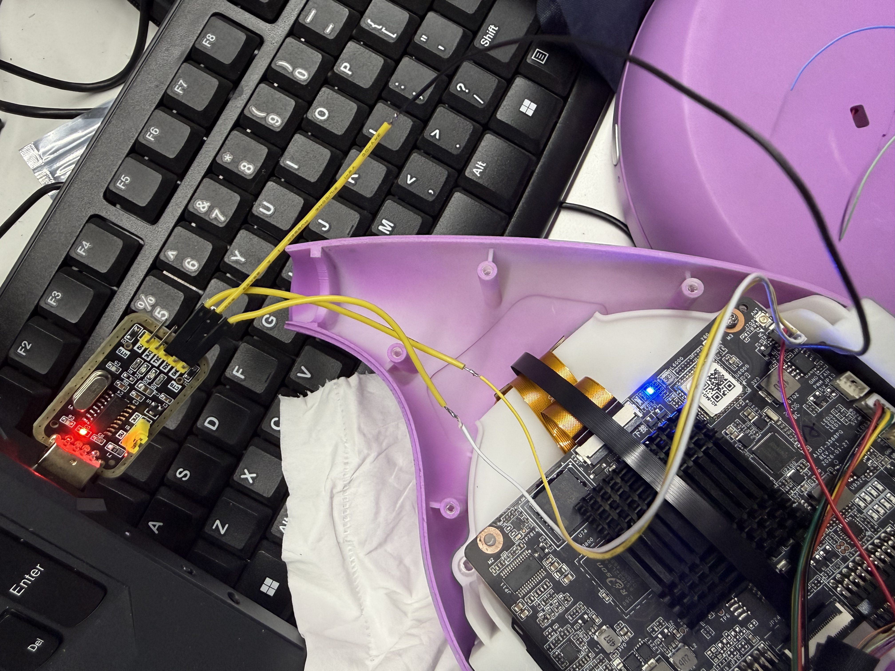

# 从原厂 Android 临时启动 Linux

因为拿到机器人是原厂的Android系统，另开发了Linux版本的，由于没有正式上线，因此采用的是保留原厂 Android 和原厂 U-Boot，借用 Android 暂存启动包，由 U-Boot 从 RAM 启动 PatchX Linux，重启后回到 Android。

## 1. 准备原厂环境并备份

开机时板上已经运行匹配的原厂 Android，直接从备份开始。原厂整包的封装依供应商而定，下面从运行的 Android 读取实际分区。

临时切换系统需要用调试串口进入 U-Boot。



准备 Linux 或 WSL 主机、ADB 和板卡调试串口。实测串口为 1500000、8N1、无流控。先确认能看到 Android 与 U-Boot 的串口输出，且设备拥有读取原厂分区的授权。下列命令以原厂 Android 的 ADB shell 支持 `su 0` 为例。在多设备环境设置 `ANDROID_SERIAL` 后再执行。主机命令示例使用 Bash。

```sh
adb devices -l  # 列出连接的设备的详细信息
adb shell 'getprop ro.product.model; uname -r; su 0 id' # 设备型号
BACKUPS="$HOME/patchx-3568a-stock"  # 在本地pc备份目录
mkdir "$BACKUPS" || exit 1          # 创建备份目录
adb exec-out su 0 cat /dev/block/by-name/boot > "$BACKUPS/boot.img" # 以root权限读取设备的`boot`分区，并备份
adb exec-out su 0 cat /dev/block/by-name/dtbo > "$BACKUPS/dtbo.img" # 以root权限读取设备的`dtbo`分区，并备份
adb shell 'su 0 sha256sum /dev/block/by-name/boot /dev/block/by-name/dtbo'
sha256sum "$BACKUPS/boot.img" "$BACKUPS/dtbo.img"
```

板端已配置 SSH 且账号有权限读取分区时，也可以用 SSH 执行等效的只读备份命令。

对比板端和主机的散列。实测兼容的原厂 `boot` 是 40 MiB，`dtbo` 是 4 MiB。打包器还会核对已实测的 SHA-256。散列与实测固件组合不符时，需要单独适配该板的启动链。

## 2. 构建内核与准备早期用户空间

```sh
git clone --branch linux --single-branch https://github.com/patchx2027/Patchx-OpenDeskRobot.git
cd Patchx-OpenDeskRobot
```

按[内核构建](BUILD.md)执行旧板产品配置对应的 Image、modules 和 DTB 构建，保留同一个 shell 中的 `OUT` 和 `BUILD_ROOT`。打包另需 Python 3.9 或更新版本、`device-tree-compiler`（提供 `fdtoverlay` 和 `fdtget`）、GNU cpio 和 gzip。

已有兼容 initramfs 时可以直接使用。第一次验证建议先做可进串口的最小 initramfs。将 `BUSYBOX` 设为你准备好的静态 ARM64 BusyBox 的绝对路径。它须提供 `sh`、`mount`、`uname`、`setsid`、`cttyhack`、`sleep`、`insmod`、`cat`、`sync`、`reboot` 以及 `--install -s`。用 `file "$BUSYBOX"` 确认架构和静态链接。

```sh
INIT_ROOT="$BUILD_ROOT/initramfs"
INITRAMFS="$BUILD_ROOT/initramfs.cpio.gz"
mkdir "$INIT_ROOT" || exit 1
mkdir "$INIT_ROOT"/{bin,dev,proc,sys,tmp}
install -m 755 "$BUSYBOX" "$INIT_ROOT/bin/busybox"
ln -s busybox "$INIT_ROOT/bin/sh"
aarch64-linux-gnu-strip --strip-debug \
  -o "$INIT_ROOT/snd-soc-rk817.ko" "$OUT/sound/soc/codecs/snd-soc-rk817.ko"
cat > "$INIT_ROOT/init" <<'INIT'
#!/bin/sh
set -eu
/bin/busybox --install -s /bin
export PATH=/bin
mount -t devtmpfs devtmpfs /dev
mount -t proc proc /proc
mount -t sysfs sysfs /sys
mount -t tmpfs tmpfs /tmp
echo PATCHX_RAM_READY
uname -r
while :; do
    setsid cttyhack sh -i </dev/console >/dev/console 2>&1 || sleep 1
done
INIT
chmod 755 "$INIT_ROOT/init"
(set -o pipefail; cd "$INIT_ROOT" &&
  find . -print0 | cpio --null -o -H newc --owner 0:0 | gzip -n -9 > "$INITRAMFS")
```

最小环境提供串口和驱动核对。运行 PatchX 应用时还需准备 Linux 根文件系统、应用依赖和外设固件，按实际部署方式由 `/init` 启动。应用配置见[用户程序说明](../../software/linux/README.md)。

## 3. 组装 40 MiB RAM 包

```sh
tools/patchx/build-rk3568-ram-boot.py \
  --stock-boot "$BACKUPS/boot.img" \
  --stock-dtbo "$BACKUPS/dtbo.img" \
  --image "$OUT/arch/arm64/boot/Image" \
  --dtb "$OUT/arch/arm64/boot/dts/rockchip/rk3568-patchx-product.dtb" \
  --kernel-release "$(cat "$OUT/include/config/kernel.release")" \
  --initramfs "$INITRAMFS" \
  --output "$BUILD_ROOT/patchx-ram.img"
```

工具核对 Image 与 RK817 模块的 release、产品 DTB 和原厂 overlay 兼容性。包内保留原厂 logo 和产品 pre-overlay DTB，overlay 由 U-Boot 施加。记录打包命令打印的 CRC32 和 SHA-256。

## 4. 从 Android 暂存，再由 U-Boot 启动

在 Android 上选择 U-Boot 可读的文件系统。实测示例用 `/cache`，在该板的 U-Boot 分区号是 `mmc 0:c`。先核对板端实际分区和可写空间，给 40 MiB 文件留出额外空间。下列示例需要有权向 `/cache` 写入普通文件的 root ADB。

```sh
adb shell 'df -h /cache'
adb shell 'mkdir /cache/patchx-ram'
adb push "$BUILD_ROOT/patchx-ram.img" /cache/patchx-ram/boot.img
adb shell 'sha256sum /cache/patchx-ram/boot.img; sync'
```

SHA-256 一致后重启 Android，在调试串口出现 U-Boot 时按 Ctrl+C 停在 `=>`。先执行 `bdinfo` 和 `part list mmc 0`，确认板型、内存范围和 `cache` 分区。然后把普通文件读入 RAM：

```text
ext4load mmc 0:c 20000000 /patchx-ram/boot.img
printenv filesize
crc32 20000000 2800000
```

只有读满 41943040 字节、`filesize=0x2800000` 且 CRC32 与本轮打包输出一致时才继续。以下设置只存在于本次 U-Boot 会话。

```text
setenv kernel_addr_r 400000
setenv fdt_addr_r a100000
setenv ramdisk_addr_r 4000000
setenv initrd_high ffffffffffffffff
setenv fdt_high ffffffffffffffff
setenv bootargs console=ttyFIQ0 earlycon=uart8250,mmio32,0xfe660000 rdinit=/init ro loglevel=7 panic=0
bootm 20000000
```

## 5. 确认 Linux 已启动并返回 Android

串口出现 `PATCHX_RAM_READY` 后，用 `uname -r` 与构建时的 `kernel.release` 核对。需要检查音频驱动时执行 `insmod /snd-soc-rk817.ko`，再用 `cat /proc/asound/cards` 查看声卡。测试结束，关闭运行的应用并卸载临时挂载。上述最小环境可以执行 `sync` 和 `reboot -f` 返回原厂 Android，看到 Android 启动后再清理本轮暂存的普通文件。

使用 2026 年 11 月 15 日实测的同组输入，打包入口生成了与旧板实测包逐字节一致的文件，CRC32 为 `9f9ec0e9`。每次应比对本轮输出的 CRC32。使用该次产品配置，旧板已完成 RAM 启动、PatchX 本地播放和重启返回原厂 Android。外设接入见[产品首页](../../README.md#外设与接入)。
