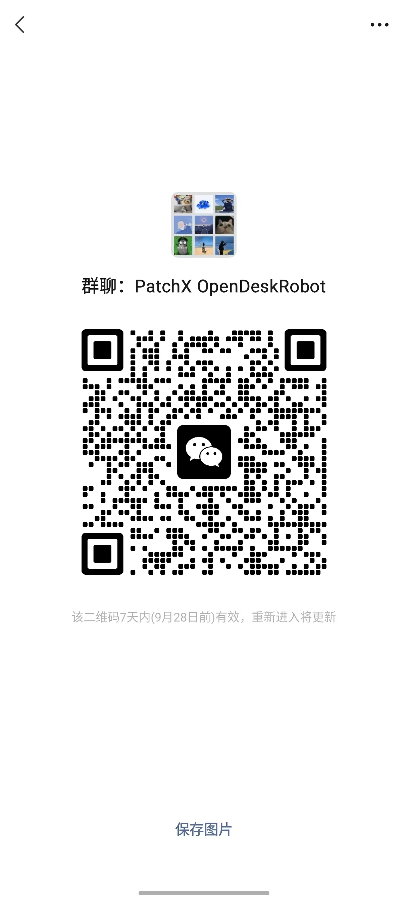

# PatchX OpenDeskRobot

PatchX 桌面机器人开源项目，面向语音交互、角色表现、视觉处理和设备控制的开发与交流。

目前公开 Android 应用源码、RK3568 设备树参考，以及经过实机验证的 Linux 驱动补丁。Android 代码位于 [`software/android/`](software/android/README.md)。当前缺少 Unity 工程和部分第三方输入，尚不能仅凭本仓库构建完整 APK；不提供 Android 系统镜像或电机控制器固件。

## 开始阅读

- [Android 工程说明与构建准备](software/android/README.md)
- [RK3568 设备树](hardware/rk3568/device-tree/README.md)
- [设备树阅读与修改教程](hardware/rk3568/device-tree/GUIDE.md)
- [RK3568 Linux 驱动与验证记录](hardware/rk3568/drivers/linux-5.10/README.md)
- [第三方依赖与待补输入](software/android/docs/THIRD_PARTY.md)
- [发布范围、来源与验证状态](software/android/docs/RELEASE_STATUS.md)

## 目录

```text
software/android/     Android 应用源码、资源与构建配置
hardware/rk3568/       RK3568 设备树、Linux 驱动补丁与验证说明
LICENSE               第一方代码的 MIT 许可证
qr-group.png          微信讨论群二维码
```

首次导入来自原 Android 仓库提交 `ed91ef7486cdebca00aa32d497f5aa45cb226c0e` 中的 `PatchX-Android-Main-C/`，以清理后的快照加入本仓库，保留本仓库既有历史，不引入原 Android 仓库历史。

## 参与项目

欢迎通过 Issues 说明问题、补充复现条件，通过 Pull Request 改进代码和文档。涉及 SDK、模型或其他外部资源时，请一并提供来源、版本和适用许可；请勿提交账户凭据、私钥、设备授权文件或个人数据。

微信讨论群 / WeChat Group：扫描下方二维码，若已失效请通过仓库 Issues 联系维护者。



## 许可证

第一方代码采用 [MIT License](LICENSE)。第三方代码、SDK、模型和素材遵循各自的许可，原有第三方声明应予保留；本仓库的 MIT 许可证不替代其授权条款。尚待核对的资源记录在 [第三方清单](software/android/docs/THIRD_PARTY.md)，当前未随源码分发。
